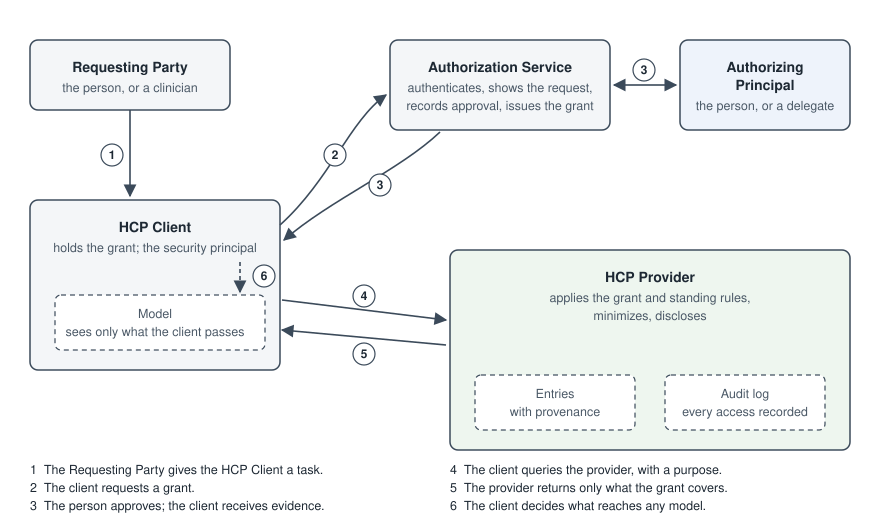
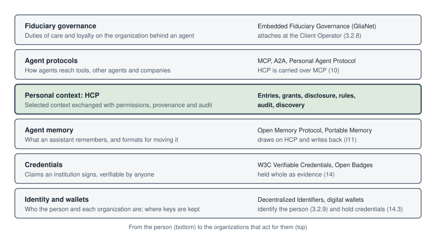

> **DRAFT — Not for distribution.** Human Context Protocol (HCP) v2, Draft Specification, version 2.0-draft-3. Pages: [Introduction](introduction.md) · [Specification](specification.md) · [Guides](guides.md) · [Path to v2 Final](path-to-v2-final.md)

# Introduction

This page introduces HCP: what it is for, how it works in brief, who takes part, worked use cases, what it covers, and how it relates to other work. It is informative. The Specification follows, then the Guides, and the Path to v2 Final, which says what remains open. Readers new to HCP can begin with I3, and I8 says where each audience will find what it needs.

## I1 Purpose

This document specifies the Human Context Protocol (HCP) version 2, an open, person-governed standard for representing, storing, and sharing personal AI memory and preferences across systems.

HCP addresses a structural problem in how AI personalization works today: personal context (the preferences, goals, constraints, and history that make AI assistance genuinely useful) is held inside platform-specific silos. It cannot move with the person. It cannot be inspected or corrected in a meaningful way. And it accumulates value for the platform, not the individual.

HCP inverts this. It establishes personal context as a portable, person-governed layer that sits above any single AI provider. Applications and assistants query a person's HCP instance for the context they need, under explicit authorization, for a purpose the person approved, and for a limited time unless the person chooses otherwise. The person can see who accessed what and when, correct what is stored, and revoke access at any time.

## I2 Core Principle

**The person, not the vendor, owns their memory.**

This is a philosophical and architectural principle. Every design decision in this specification (how context is stored, how access is granted, how inferences are labeled, how revocation propagates) follows from it.

## I3 HCP in Brief

An AI assistant is more useful when it knows something about the person it is helping: that she is vegetarian, that he is studying for a nursing exam, that her blood pressure medication changed last month. Today each assistant keeps what it learns in its own store. The person cannot take that context to another assistant, cannot easily see what is held, and cannot correct it. HCP gives that context a home the person controls.

**Where context lives.** A person's context is held by an HCP Provider, a service the person chooses. It may be run by a company, a public institution or a community organization, or by the person on their own device ([3.2.4](specification.md#324-hcp-provider)). The person can move to another provider and take their context with them ([5.4.1](specification.md#541-export), [5.4.3](specification.md#543-import)).

**How context is created.** Context arrives in one of three ways. The person states it. An application or a model infers it, for example from a conversation. Or an institution attests to it, as a clinic does when it records a vaccination, or a school when it records a completed course. Each piece of context records which of these it is, and who said it ([3.5](specification.md#35-provenance-layers), [4.4](specification.md#44-declaration-types)). An inference stays labelled as an inference until the person confirms it ([3.8](specification.md#38-confirmation)).

**How applications connect.** An application asks the person for access to some kinds of context, for purposes it states, and usually for a limited time. The person approves on a screen, in a chat or by voice ([G4](guides.md#g4-authorization-interaction-patterns)). The application then asks the provider for what it needs, over the web ([9](specification.md#9-http-binding)) or through the Model Context Protocol that AI assistants use ([10](specification.md#10-mcp-binding)), and receives only what the person's approval covers. Every access is recorded in a log the person can read, and the person can withdraw access at any time.

HCP is built from six building blocks.

| Building block | What it is | Where |
|----------------|------------------------------------------------------------------------|--------|
| Entries | One piece of context about a person: what is said, who said it, how HCP classifies it, the evidence behind it, and its history | 4 |
| Grants | The person's permission for one application to read or add some kinds of context, for stated purposes and a stated time | 6.1, 6.2 |
| Disclosure | What an application receives under a grant: only what the grant covers, reduced to what the request needs, with a time after which the application stops using it | 7 |
| Rules | Standing rules the person sets once for every grant, such as never sharing health context with an advertiser, and directives that tell agents what they may do with context, such as signing for the person | 6.3, 6.4 |
| Audit | A log, which the person can read, of every grant, every access and every change | 8 |
| Discovery | A document in which a provider says what it supports, so that applications can connect without prior arrangement | 19 |

## I4 Roles and Where HCP Sits

**The roles.** HCP names each party by what it does ([3.2](specification.md#32-roles)). One organization often plays several roles. The repository's Introduction page draws the roles in a read, and the layers below, as diagrams; these tables are their text.

| Role | Usually | What it does |
|----------------|--------------------------------------|------------------------------------------------------------------|
| Context Subject | The person | The person the context is about ([3.2.1](specification.md#321-context-subject)) |
| Authorizing Principal | The person, or a delegate such as a parent | Approves grants and governs the context ([3.2.2](specification.md#322-authorizing-principal), [17](specification.md#17-delegated-authorization-profile)) |
| HCP Client | An assistant, an agent, a clinic's or a school's system, or the person's own management application | Software that asks for and uses context under a grant ([3.2.3](specification.md#323-hcp-client)) |
| HCP Provider | A service the person chooses | Holds the context, enforces grants, and keeps the log ([3.2.4](specification.md#324-hcp-provider)) |
| Authorization Service | Usually run with the provider | Authenticates the person, shows them what is asked, and issues the grant ([3.2.5](specification.md#325-authorization-service)) |
| Context Asserter | The person, a model, or an institution | Whoever made a statement that becomes an entry ([3.2.6](specification.md#326-context-asserter)) |
| Requesting Party | The person, or someone acting with the client, such as a clinician | Whoever the client is working for in a task ([3.2.7](specification.md#327-requesting-party)) |
| Client Operator, Provider Operator | The organizations behind the client and the provider | The parties accountable for each ([3.2.8](specification.md#328-client-operator-and-provider-operator)) |

In a typical read, the person's assistant asks for a grant; the Authorization Service shows the person what is asked and records their approval; the assistant then queries the provider, which returns only what the grant covers and records the access. 3.13 gives this sequence, and those for a write by a model and for revocation, step by step.

*The roles in a read, step by step (3.13).*

**Where HCP sits.** HCP is one layer among several that together aim at agents that serve the person they act for ([I10](#i10-related-work)).

| Layer | What it provides | Examples | How it meets HCP |
|----------------|----------------------------------------|----------------------|------------------------------------------|
| Identity and wallets | Who the person and each organization are; where their keys and credentials are kept | Decentralized Identifiers, digital identity wallets | The Authorization Service establishes who the person is ([3.2.9](specification.md#329-how-each-role-is-identified)); a wallet can act as the holder of credentials ([14.3](specification.md#143-roles)) |
| Credentials | Claims an institution signs, verifiable by anyone | W3C Verifiable Credentials, Open Badges | Held whole as an entry's evidence ([14](specification.md#14-vc-evidence-profile)) |
| Personal context (HCP) | The exchange of selected context with permissions, provenance and audit | — | — |
| Agent memory | What an assistant remembers for its own work, and formats for moving it | Open Memory Protocol, Portable Memory | An assistant's memory can draw on context from HCP and write back to it ([I11](#i11-hcp-and-related-protocols)) |
| Agent protocols | How agents reach tools, other agents and companies | MCP, A2A, Personal Agent Protocol | HCP is carried over MCP ([10](specification.md#10-mcp-binding)); I11 compares the others |
| Fiduciary governance | Duties of care and loyalty on the organization behind an agent | Embedded Fiduciary Governance (GliaNet) | Attaches at the Client Operator, named in every grant ([3.2.8](specification.md#328-client-operator-and-provider-operator)) |

*Where HCP sits among neighbouring layers.*

## I5 Worked Use Cases

**Nomsa: maternal care over WhatsApp.** This journey follows Turn.io's health demonstration at the Portable Memory workshop (October 2026), which ran on synthetic records. Nomsa is 26, twenty-eight weeks into her second pregnancy, and treated for mild anaemia. She keeps her health context in a record she controls, and talks to her clinics on WhatsApp.

1. At her 28-week check-in, the AI nurse of her private clinic, Unjani, asks on WhatsApp whether it may open her record to help her today. She replies yes: a grant to the clinic's client for this conversation ([6.1.4](specification.md#614-grant-distinction-temporary-vs-persistent), [G4](guides.md#g4-authorization-interaction-patterns)).
2. She asks when her last visit was and what her blood results showed. The nurse answers from documents the clinic attested to at her 27-week visit: her haemoglobin, the anaemia, and the iron, folic acid and calcium she was prescribed ([3.7](specification.md#37-statements-attributed-to-the-context-subject)).
3. In conversation, the nurse's model infers that Nomsa has stopped taking her medication. It records the inference only after Nomsa confirms it, as hers to agree to ([16.2](specification.md#162-health-context-profile), [3.8](specification.md#38-confirmation)).
4. Nomsa wants to give birth at Hope Street, the public maternity unit, which today cannot get her history from Unjani. She taps Share. That approves a grant for Hope Street's own client: Unjani does not pass her record on ([3.12](specification.md#312-onward-disclosure)).
5. Hope Street messages her from its own number, already knowing that she is 28 weeks, when she is due, and her treatment, and that her sister is her support person, a fact Nomsa stated herself. Her log shows each clinic's access, and she can withdraw either grant ([8.6](specification.md#86-disclosure-summary)). Any copy a clinic is required by law to keep in its own medical record, it declared when she approved ([6.2.5](specification.md#625-copies-kept-under-a-legal-obligation)).

**Achieng: teacher development.** Achieng teaches in a primary school and follows a professional-development course on her phone, of the kind Turn.io's LearnPass delivers.

1. She approves a grant for the course's coaching assistant to read and add to her work and learning context ([6.1](specification.md#61-grant-model)).
2. The coach guesses from her questions that large classes are her main difficulty. The guess is recorded as the coach's inference and shown to her first. She corrects it: marking is the real difficulty. The corrected version is her own statement, and outranks any later guess of the coach's that contradicts it ([3.8](specification.md#38-confirmation), [4.7](specification.md#47-conflicts)).
3. When she completes a module, the course issues a credential, which her provider holds whole ([14](specification.md#14-vc-evidence-profile)).
4. Her district supervisor sees her completed modules and nothing else: the supervisor's grant is narrowed to those credentials ([6.1.5.1](specification.md#6151-narrowed-grants)).
5. When she moves to another district, she approves a grant for its programme to read her credentials and her own account of her goals, and withdraws the old supervisor's access.

**A guardian and a learner.** Maya is fourteen and in ninth grade at a public high school in the United States, where her school offers a tutoring application.

1. Her mother acts for her as a delegate under the Delegated Authorization Profile. The school's enrollment record of the relationship is the basis, and the delegation covers Maya's learner profile and her goals (17.2–17.4, [G2.4](guides.md#g24-guardian-consent)).
2. Her mother approves a grant for the tutoring application. The school is not a delegate; its systems act only under grants her mother approves ([17.1](specification.md#171-scope)).
3. Maya tells the tutor she learns best from worked examples, and that is recorded as her own statement ([G2.2](guides.md#g22-example-pacing-stated-in-a-tutoring-application)). She can withdraw any grant made for her ([17.5](specification.md#175-the-context-subjects-override)).
4. At eighteen, the age of majority in most states, every grant her mother approved lapses. Maya sees a summary of the delegated period and approves again what she wants to keep. Her mother keeps read access to the record of the grants she approved ([17.6](specification.md#176-ending-a-delegation), [17.7](specification.md#177-audit-access)).

**A vaccination record.** Amina, 31, is vaccinated against hepatitis B at a district clinic, in the kind of setting the Gates Foundation's immunization work serves.

1. The clinic issues a credential recording the vaccine, the product, the batch and the date, signed by the clinic. Amina's provider holds it whole ([14.2](specification.md#142-credential-and-signature-boundary)).
2. She moves to another district and changes provider. Export and import carry the credential unaltered, and its signature still verifies, so the product and batch survive every move ([5.4.1](specification.md#541-export), [5.4.3](specification.md#543-import)).
3. If the clinic finds an error, such as a wrong batch number, it revokes the credential, and any application that checks its status sees that ([14.7](specification.md#147-credential-status)).
4. When she applies for work at a hospital that requires proof of vaccination, the hospital needs that proof and not her history. Under a grant she approves for that purpose, it receives a derived credential revealing only the claims it needs, where the credential's format allows that ([14.9](specification.md#149-selective-disclosure)), and checks the clinic's signature itself ([3.6](specification.md#36-asserter-assurance)).

## I6 What HCP Covers

HCP defines:

- An actor and provenance model: who takes part, what each party is accountable for, and how an entry records who asserted it, which client submitted it, and under which grant ([3](specification.md#3-actors-and-provenance))
- A data model for personal context: an entry that keeps apart what is said, who asserted it, how HCP classifies it, the evidence behind it, and its record and lifecycle. What is said may be a statement in natural language, or a Verifiable Credential for an institutional claim ([4](specification.md#4-data-model), [11](specification.md#11-general-context-profile), [14](specification.md#14-vc-evidence-profile))
- Operations with specified semantics on two planes: context operations for applications acting under a grant, and governance operations reserved to the person ([5](specification.md#5-operations-and-errors))
- An authorization model based on revocable grants scoped to categories and to purposes the person approved, temporary by default, obtained through OAuth 2.0 or, for an implementation's own applications, another authenticated channel; and standing rules the person sets once for every grant ([6](specification.md#6-authorization), [12](specification.md#12-first-party-authorization-profile), [13](specification.md#13-oauth-interop-profile))
- Disclosure and minimization rules, including how long a disclosed copy may be used, and an audit log the person can inspect ([7](specification.md#7-disclosure-and-minimization), [8](specification.md#8-audit))
- Two bindings: HTTP, for server-to-server integration and the person's own management, and MCP, for agent-native access ([9](specification.md#9-http-binding), [10](specification.md#10-mcp-binding))
- Profiles that add stricter rules for a domain (health, education), a security posture, a type of evidence, or authority held by someone other than the person (11–17)
- Conformance claims and packages, a discovery document, and conformance testing (18–20)
- Guides for pilots and deployments (G1–G5)

## I7 What HCP Does Not Cover

The following are known open problems. Each is deferred to keep pilots tractable, and each has a home in this specification and a planned draft ([P1](path-to-v2-final.md#p1-roadmap)).

- Automated resolution of conflicts, without the person's own act
- On-device or federated execution
- Cross-HCP federation (person-to-person or institution-to-institution sharing)
- Elicitation: how applications draw context out of a person in the first place
- Emergency access, and approval by a person with no device of their own
- Onward sharing beyond Low-sensitivity context, and assurance about the systems that receive context
- Delegation beyond one level

HCP limits what context a model receives and what it may write, and holds clients accountable for what they do with it. It does not constrain a model's other capabilities: a general-purpose model with access to tools may take destructive actions whether or not its client conforms to HCP.

## I8 Intended Audiences

HCP is written for several audiences:

- **Engineers building HCP Providers:** in the Specification, Part I (Core), the binding or bindings they expose (Part II), the profiles they claim (Part III), and Part IV (Conformance).
- **Engineers building applications and agents that use HCP:** Part I, especially the actor invariants ([3.11](specification.md#311-actor-invariants)) and onward disclosure ([3.12](specification.md#312-onward-disclosure)), and the binding they call (Part II).
- **Authors of bindings, profiles, and implementation guides:** Specification §1, which sets the rules they follow.
- **Pilot teams:** the Guides: pilot onboarding ([G1](guides.md#g1-pilot-onboarding)), the guide for their domain ([G2](guides.md#g2-education-guide), [G3](guides.md#g3-health-guide)), and the deployment patterns ([G5](guides.md#g5-deployment-patterns)).
- **Non-technical stakeholders:** this page, especially HCP in brief ([I3](#i3-hcp-in-brief)), the roles ([I4](#i4-roles-and-where-hcp-sits)) and the worked use cases ([I5](#i5-worked-use-cases)); the plain-language table of operations ([5.1](specification.md#51-operations)), and the Path to v2 Final ([P1](path-to-v2-final.md#p1-roadmap)), which says what remains open without requiring the protocol sections.

## I9 Relationship to Existing Standards

HCP does not create a bespoke format where existing open standards suffice. It is built on:

- **JSON-LD (W3C):** for linked, machine-readable context with human-readable structure
- **W3C Verifiable Credentials Data Model 2.0:** for cryptographically provable, high-stakes claims ([14](specification.md#14-vc-evidence-profile))
- **W3C VC Data Integrity (cryptosuites eddsa-rdfc-2022 and ecdsa-sd-2023) and W3C Securing Verifiable Credentials using JOSE and COSE (VC-JOSE-COSE):** as the securing mechanisms for credentials, with eddsa-rdfc-2022 mandatory to verify ([14.5](specification.md#145-securing-credentials))
- **W3C Bitstring Status List v1.0:** for credential revocation and suspension ([14.7](specification.md#147-credential-status))
- **Open Badges 3.0 (1EdTech):** for learner context portability in education pilots ([14.4](specification.md#144-example), [16.4](specification.md#164-education-context-profile))
- **OAuth 2.0 (RFC 6749), with PKCE (RFC 7636) and the Device Authorization Grant (RFC 8628):** for scoped, revocable authorization. HCP defers to OAuth for the authorization mechanism under the OAuth Interop Profile ([13](specification.md#13-oauth-interop-profile)), which follows the OAuth 2.0 Security Best Current Practice (RFC 9700) and uses Rich Authorization Requests (RFC 9396), Resource Indicators (RFC 8707) and Protected Resource Metadata (RFC 9728).
- **Security Event Tokens (RFC 8417), delivered by push (RFC 8935):** for revocation notifications ([9.9](specification.md#99-revocation-notification-delivery))
- **Model Context Protocol (MCP), version 2026-07-28:** for agent integration ([10](specification.md#10-mcp-binding))
- **Problem Details for HTTP APIs (RFC 9457):** for HTTP error responses ([9.7](specification.md#97-errors))

Where these standards are insufficient, HCP defines minimal extensions. Where they are sufficient, HCP defers to them entirely.

The organization of this specification into a Core, bindings, profiles, and implementation guides ([1](specification.md#1-about-this-specification)) follows established practice in protocols such as HL7 FHIR, SCIM, and JMAP, as surveyed by Lucas Novak (Stanford).

## I10 Related Work

HCP is not the only effort addressing portable, governed personal context for agentic systems. The closest parallel is the **1EdTech Trusted Portable Learning Context (TPLC)** initiative, which addresses the same structural problem — that agent memory alone is insufficient for context that must move with a person, carry provenance, and be shared under consent — from the education sector's vantage.

The two efforts are complementary rather than competing, and they converge on the same underlying standards: W3C Verifiable Credentials, Decentralized Identifiers, Open Badges and Comprehensive Learner Record, and the Model Context Protocol. 1EdTech's revised RFC (v2) is in public comment. HCP aligns its VC Evidence and Education Context Profiles to Open Badges 3.0 ([14.4](specification.md#144-example), [16.4](specification.md#164-education-context-profile)), which is 1EdTech's. The efforts differ in vantage: TPLC describes an institution-side service that compiles trusted context from source systems, while HCP describes a person-side, person-governed instance that holds and releases context under the person's control. TPLC's personal-device agent tier corresponds closely to the holder of an HCP instance ([14.3](specification.md#143-roles)), which suggests the two can interoperate rather than overlap: an institution's TPLC service could be both an issuer of credentials held in a person's HCP instance and an HCP Client that reads from it under a grant.

A second related effort is the **Personal Data Portability Protocol (PDPP)**, developed in PDP-Connect, a Linux Foundation Decentralized Trust lab initiated by the Vana Foundation. PDPP specifies how a person authorizes an application's ongoing access to their personal data, and how that authorization is enforced: a grant names the application, the data source, the fields, a date range, a purpose, and an expiry, and is recorded where both the person and the application can see it. It profiles OAuth 2.0 and Rich Authorization Requests (RFC 9396) for personal data. PDPP addresses personal data held by services generally; HCP addresses the context an AI assistant draws on, including provenance for assertions a model made. The two share an authorization pattern, and PDPP informed this draft's purposes and structured authorization details ([6.1.5](specification.md#615-grant-representation), [6.1.5.2](specification.md#6152-purposes)). PDPP 0.1.0 is in public review as of October 2026.

Participants in the October 2026 Portable Memory workshop at Stanford have begun describing a **Pro-Human AI Stack**: digital identity, wallets, Verifiable Credentials, portable memory, HCP and fiduciary governance, aimed together at agents that are loyal to the people they serve. HCP's role in that stack is the exchange of selected context with permissions, provenance and auditability. Two neighboring efforts supply what HCP leaves open. **Verifiable Trust Infrastructure**, compared with HCP by Drummond Reed (OpenVTC), covers identity, key custody, trust registries for deciding which receiving systems to trust, and unlinkable selective disclosure. **Embedded Fiduciary Governance**, from Richard Whitt (GliaNet), places duties of care, fidelity and loyalty on an accountable organization rather than on the agent. HCP already names that organization in every grant, as the Client Operator ([3.2.8](specification.md#328-client-operator-and-provider-operator)), which is where a fiduciary commitment would attach. Governance of credential ecosystems is also the subject of a proposed ISO/TC 307 work item on workforce microcredentials, raised in public comments on 1EdTech's RFC.

Alignment on shared standards, and on the vocabulary questions deferred to a later draft ([P1](path-to-v2-final.md#p1-roadmap)), is a candidate collaboration for the post-pilot period. Learning Economy Foundation reviewers have also noted adjacent payload standards relevant to education, including xAPI and IEEE LearnerState objects ([G2.3](guides.md#g23-credentials)), and multi-agent protocol work at IEEE and the Decentralized Identity Foundation ([P1](path-to-v2-final.md#p1-roadmap)).

## I11 HCP and Related Protocols

| Protocol | Steward and version | Its goal |
|----------------|----------------------|------------------------------------------|
| Personal Agent Protocol | Sierra and Meta; draft 0.3 | Letting a person's agent work with a company for them, across its website, its APIs and its own agent |
| Open Memory Protocol | Open Memory Protocol Initiative, hosted at the AI Disclosures Project, co-hosted by Mozilla and IBM; early drafts | Memory that moves between AI agents and services |
| Model Context Protocol (MCP) | Revision 2026-07-28 | Connecting AI applications to tools and data |
| Agent2Agent (A2A) | Linux Foundation; 1.0 | Letting agents from different vendors find each other and hand over tasks |
| Solid | W3C Solid Community Group, Protocol 0.11; the Linked Web Storage Working Group | Personal data stores, under the person's access control, on web standards |

HCP's goal is different from each: to let a person decide which applications and agents may use their context, for what, and for how long, and to see each use.

**Personal Agent Protocol.** Both serve a person through an agent, and both use OAuth for the person's approval. They differ in these ways:

- **What moves.** The Personal Agent Protocol moves the agent's requests and actions with a company: a return, a booking, an account change. HCP moves context about the person.
- **Where the data is.** The Personal Agent Protocol holds nothing about the person; the company keeps its account data, and the agent's identifiers for the person are pseudonymous. HCP holds the person's context with a provider they choose.
- **What the person approves.** Under the Personal Agent Protocol, scopes on an account at one company. Under HCP, categories of their own context, for stated purposes and a stated time ([6.1](specification.md#61-grant-model)).
- **Record.** The Personal Agent Protocol ties a person's activity together across a company's channels. HCP keeps a log, which the person reads, of every use of their context ([8](specification.md#8-audit)).

The two fit together: a personal agent draws on HCP for what it needs to know about the person, and acts with companies over the Personal Agent Protocol. Where the person allowed it when approving the agent's grant, the agent can tell a company what a task needs from Low-sensitivity context, such as a clothing size, and reports each time it does ([3.12](specification.md#312-onward-disclosure)). A company that needs more obtains its own grant.

**Open Memory Protocol.** Both aim at memory that is not locked to one vendor. The initiative is comparing several early proposals, so the differences below are as its drafts stand:

- **The unit.** Its drafts treat an agent's or a service's memory as what moves. HCP's unit is an entry about a person, with who asserted it and on what evidence ([4](specification.md#4-data-model)).
- **Who decides.** Its drafts concentrate on format and transfer between systems. HCP adds the person's grants, purposes and a log they read ([6](specification.md#6-authorization), [8](specification.md#8-audit)).
- **Inferences.** HCP labels what a model inferred apart from what the person said, and gives the person's statement standing ([3.8](specification.md#38-confirmation), [4.7](specification.md#47-conflicts)). Some of the initiative's proposals carry comparable provenance and lineage.

The two could align: an agent's memory, held in the initiative's format, could draw context from HCP and write back to it under a grant. This is a candidate for collaboration.

**Model Context Protocol (MCP).** MCP is how AI applications reach tools and data; HCP uses it. They differ in these ways:

- **Layer.** MCP is a general transport for any tool or data source. HCP defines what personal context is, and the rules for using it.
- **Authorization.** MCP authorizes a client to reach a server. HCP grants are per person, per category, with purposes and an end time, and are enforced by the provider ([6](specification.md#6-authorization), [13.5](specification.md#135-mcp-authorization)).
- **Record.** MCP leaves logging to each server. HCP requires a log the person can read ([8](specification.md#8-audit)).

HCP's MCP Binding carries context operations as MCP tools ([10](specification.md#10-mcp-binding)).

**Agent2Agent (A2A).** A2A lets agents built by different vendors discover each other, hand over tasks and exchange the results. Both connect agents to things outside themselves, and both use OAuth. They differ in these ways:

- **Who is served.** A2A serves the agents and the organizations that run them. HCP serves the person the context is about.
- **What moves.** A2A moves tasks, messages and their results. HCP moves entries about a person, each with who asserted it and on what evidence.
- **Who approves.** In A2A, the agents' operators agree to work together. In HCP, the person approves each grant ([6.1](specification.md#61-grant-model)).
- **Context passed along.** A2A can carry anything one agent sends another. Under HCP, an agent may tell another organization's agent only what a task needs from Low-sensitivity context, and only where the person allowed it; otherwise the receiving agent obtains its own grant from the person ([3.12](specification.md#312-onward-disclosure)).
- **Record.** A2A tracks the state of a task. HCP keeps a log the person can read of every use of their context ([8](specification.md#8-audit)).

The two can be used together: an agent that receives a task over A2A, and needs the person's context to do it, asks for a grant under HCP.

**Solid.** Both start from data the person holds, under their control, on web standards. They differ in these ways:

- **What is stored.** Solid stores any kind of data. HCP specifies one kind, context for AI, with an entry model that labels inferences and records provenance ([4](specification.md#4-data-model)).
- **What is granted.** Solid controls access to resources in the store. HCP grants reach categories of context, for stated purposes and until a stated time ([6.1](specification.md#61-grant-model)).
- **Record.** HCP requires a log the person can read of every use ([8](specification.md#8-audit)).

An HCP Provider could keep its entries in a Solid store.

Two efforts closer to HCP's own scope, 1EdTech's Trusted Portable Learning Context and the Personal Data Portability Protocol, are described in I10. Other work on moving AI memory between systems includes the W3C AI Agent Memory Interoperability Community Group, launched in June 2026, and MacPaw's Portable Memory format, proposed in July 2026.

## I12 Acknowledgments

The structure of this draft, its actor model, and its actor invariants come from research by Lucas Novak (Stanford).

Reviewers: Lucas Novak, Andy Lu Dai, and Zexue He (Stanford); Turn.io; Jacksón Smith, Taylor Kendal, and Jim Goodell (Learning Economy Foundation).

Inputs to Draft 2 from the October 2026 Portable Memory workshop and its follow-up: Gustav Praekelt, Simon de Haan, and Santiago Cardona (Turn.io); Jared Josleyn (Sanofi), with Thomas Hardjono and Sandy Pentland (MIT Connection Science); Drummond Reed (OpenVTC); Richard Whitt (GliaNet); Michael Feldstein (1EdTech); Taylor Kendal (Learning Economy Foundation); and Philippe-Alexandre Gilbert, Nancy Otero Ornelas, and Xiaoxue Du (Gates Foundation).

Comments on Draft 1: Richard Ng (Native), who also built an experimental MCP interface to it, and Audrey Jones (Stanford). Jonathan Jackson (Dimagi) shared lessons from building memory across many agents and people, including the case for a replayable test of whether memory changes an answer.

Outside reader: Jeremy Kepner (MIT Lincoln Laboratory), whose points on strong identities, the currency of disclosed context, and how far context spreads shaped asserter assurance ([3.6](specification.md#36-asserter-assurance)), the rule on onward disclosure ([3.12](specification.md#312-onward-disclosure)), and the disclosure rules in this draft ([7.4](specification.md#74-disclosures-to-context-clients), [7.6](specification.md#76-use-until)).

---

The specification text is licensed under CC BY 4.0 ([LICENSE-SPEC.md](../../LICENSE-SPEC.md)). These pages are built from the same source as the Word document by `tools/make_pages.py`; where they differ, please report it as an issue.
